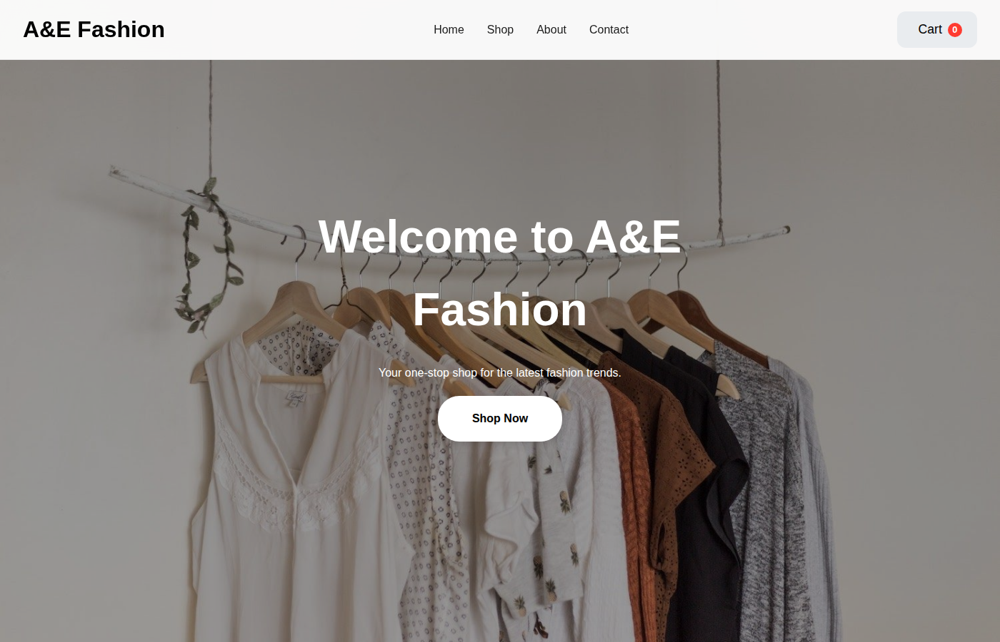
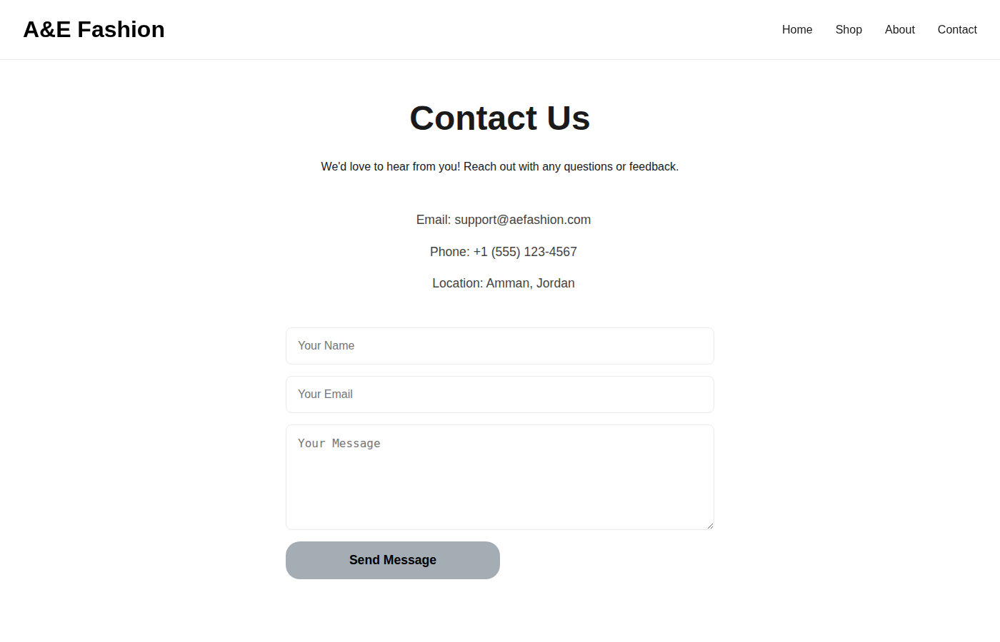
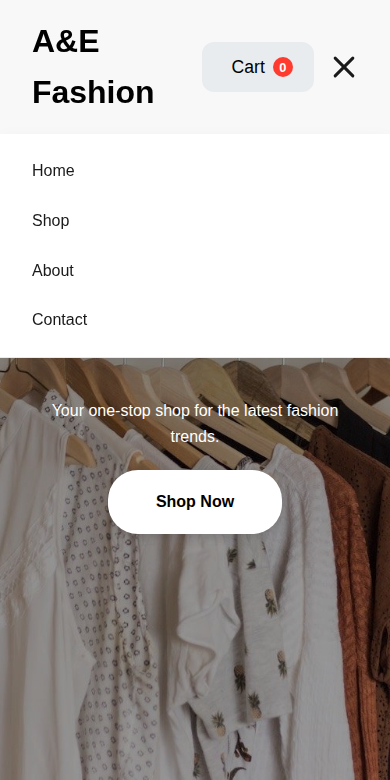

# A&E Fashion -- Clothing Store Website

[](https://github.com/Mo-Sa-2004/Clothing-Website-html-css-js/actions/workflows/lint.yml)

A responsive front-end e-commerce site for a clothing brand, built with
plain HTML, CSS, and JavaScript -- no frameworks, no build step. It has a
browsable, filterable product catalog, a working shopping cart, a
checkout form, and a contact page, all running entirely in the browser.

## Screenshots

| Home | Cart |
|---|---|
|  |  |

| Contact page | Mobile menu |
|---|---|
|  |  |

## Features

- **Product catalog** -- 12 products across three categories (men's,
  women's, accessories), rendered from a JS data array and filterable by
  category.
- **Shopping cart** -- add items, adjust quantity, remove items, and see
  a running total, all kept in memory while the tab is open.
- **Checkout flow** -- a shipping/payment form with input formatting
  (card number, expiry, CVV) and a simulated order placement (there is
  no real payment backend -- see Limitations below).
- **Contact form** -- validates the name/email/message fields, shows an
  inline success or error message, and simulates sending (again, no
  real backend yet).
- **Responsive design** -- a hamburger menu takes over the nav below
  768px, and the layout adapts down to phone widths.
- **About section** -- a short brand blurb plus feature highlights
  (shipping, materials, returns).

## Tech stack

- **HTML5** -- two pages, `index.html` and `contact.html`.
- **CSS3** -- custom properties (design tokens) for the color palette,
  Flexbox and Grid for layout, no CSS framework.
- **Vanilla JavaScript** -- no libraries beyond the DOM APIs; split into
  small, page-scoped files instead of one monolithic script.
- **[Font Awesome](https://fontawesome.com/)** -- icons, loaded from a
  CDN.

## Project structure

```
Clothing-Website-html-css-js/
|-- index.html       Homepage: hero, product grid, cart, checkout
|-- contact.html     Contact page
|-- shared.css       Header/nav/mobile-menu styles used by both pages
|-- style.css        Homepage-specific styles
|-- contact.css      Contact-page-specific styles
|-- cart-logic.js    Pure product/cart helpers (filtering, totals, ...) --
|                     no DOM access, so these are unit tested directly
|-- script.js        Product data, cart logic, checkout simulation
|-- nav.js           Mobile hamburger menu toggle (shared)
|-- contact.js       Contact form validation + submit handling
|-- test/            Unit tests for cart-logic.js (Node's built-in runner)
|-- images/          Product and hero photos
|-- screenshots/     Screenshots used in this README
`-- .github/workflows/lint.yml   CI: lint + tests on every push/PR
```

## Getting started

This is a static site with no dependencies or build step, so any of the
following will work:

1. **Just open it.** Clone the repo and open `index.html` directly in a
   browser.

   ```bash
   git clone https://github.com/Mo-Sa-2004/Clothing-Website-html-css-js.git
   cd Clothing-Website-html-css-js
   ```

2. **Or serve it locally** (recommended, since some browsers restrict
   features like relative image paths when opened via `file://`):

   ```bash
   python3 -m http.server 8000
   # then open http://localhost:8000
   ```

   Any other static file server (`npx serve`, the VS Code "Live Server"
   extension, etc.) works the same way.

## Linting & tests

ESLint and Stylelint are set up (as dev dependencies, so they don't
affect the site itself) and run automatically on every push/PR via
GitHub Actions, alongside a small unit test suite (Node's built-in
test runner -- no extra test framework dependency) for the pure
cart/filtering logic in `cart-logic.js`. To run them locally:

```bash
npm install
npm run lint        # both JS and CSS
npm run lint:js
npm run lint:css
npm test             # cart-logic.js unit tests
```

## Known limitations

This is a front-end-only project -- there is no server or database
behind it, so:

- The cart resets on page refresh (nothing is persisted).
- "Placing an order" and "sending a message" are simulated with a
  timeout; no email or payment is actually sent or charged.
- Product data lives in `script.js` rather than coming from an API.

These are intentional scope boundaries for a front-end portfolio piece,
not bugs -- but they're worth knowing before judging it as a real store.

## License

[MIT](LICENSE)
